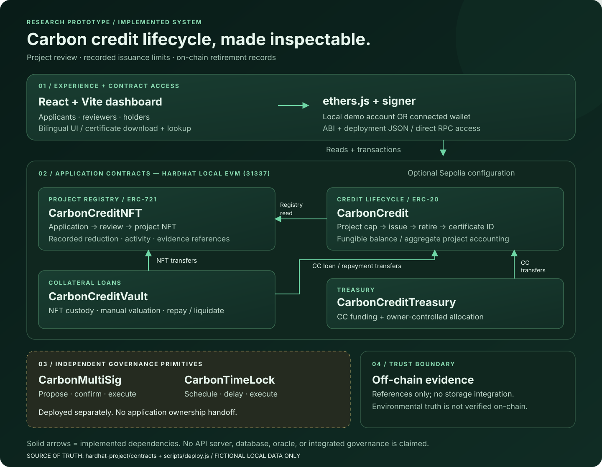

# Carbon Credit Platform

### Project review → constrained issuance → verifiable retirement

A research and portfolio prototype exploring carbon-credit lifecycle traceability on an EVM-compatible blockchain. It connects project applications, recorded issuance limits, and retirement certificates through contract state and events.

> **Scope:** a research demonstration with fictional data—not a certified carbon registry, an audited financial product, or proof of real-world emission reductions. The public frontend is live; Sepolia contracts are not deployed/configured.

**Live portfolio:** [carbon-credit-seven.vercel.app](https://carbon-credit-seven.vercel.app/) — browse without login or a wallet. Its interactive simulation runs only in the browser and does not create blockchain transactions.

[Architecture](#system-architecture) · [Quick start](#quick-start) · [Demo guide](docs/DEMO.md) · [Tests](#verification) · [Limitations](#trust-assumptions-and-limitations)

## Research motivation

**Question:** how can a verifier inspect the relationship between an approved project record, its cumulative credit issuance, and a subsequent retirement record?

The prototype separates recording an auditable lifecycle on-chain from establishing whether environmental claims are true. It implements the former; the latter depends on off-chain evidence and trusted review.

## What is implemented

| Area | Implementation | Scope |
| --- | --- | --- |
| Project registry | Applications, reviewer approval, ERC-721 records | Administrator-managed review; fictional evidence |
| Credit lifecycle | ERC-20 transfers, project issuance caps, retirement and certificate lookup | Aggregate project accounting, not per-token provenance |
| Collateral loans | NFT custody, owner-set valuation, borrowing, partial repayment and overdue liquidation | No price oracle |
| Treasury | Token funding and owner-controlled allocation | UI currently exposes treasury balance |
| Governance | Multisig proposals and delayed operations | Separate primitives; not application owners |
| Interface | Chinese/English React dashboard, local demo and optional wallet connection | Direct contract access; no application backend |

## System architecture



The frontend reads contract state/events through ethers.js and sends transactions through a local development signer or a connected wallet. Hardhat deployment writes the address manifest consumed by the frontend. There is no independent API server, database, indexer, oracle, or implemented evidence-storage service.

Solid arrows show communication or contract dependencies. Governance is deliberately separate: the deployment does not hand application ownership to multisig or timelock.

See [architecture notes and editable Mermaid diagram](docs/ARCHITECTURE.md) for relationships, accounting rules, and trust boundaries.

## Core demonstration

1. Submit a fictional project with a reduction amount and evidence reference.
2. Approve the application as a reviewer; generate a project NFT.
3. Issue CC against the project's recorded cap and global cumulative mint cap.
4. Retire CC with a project ID, beneficiary, and purpose; create a certificate ID.
5. Query the certificate from the contract and compare it with downloaded HTML.

Follow the [2–3 minute demo guide](docs/DEMO.md). The local account combines administrative roles for convenience, not independent verification.

## Quick start

Prerequisites: Node.js 20 and npm, plus internet access for first-time installation. From the repository root:

```bash
npm run demo
```

The launcher installs missing dependencies, starts Hardhat, deploys/seeds contracts when needed, starts Vite, and opens the browser. Open **http://127.0.0.1:8080/** and choose **Local Demo / 进入本地演示**. MetaMask is not required.

Keep the terminal open. Ctrl+C stops only services started by the launcher. Compatible running services and records are reused without resetting them. Local chain state is ephemeral: restarting the node loses previous transactions and certificates.

| Fresh-chain fixture | Value |
| --- | --- |
| Chain ID | 31337 |
| Demo account | 10,000 CC |
| Approved project | Hainan Solar Demonstration, NFT #1 |
| Recorded reduction / project cap | 20,000 tCO₂e / 20,000 CC |
| Vault liquidity | 100,000 CC, seeded via owner mint |
| NFT #1 manual collateral valuation | 10,000 CC |

These are illustrative values. Vault liquidity is not project-linked certified credit.

### Manual startup

Install dependencies once:

```bash
npm --prefix hardhat-project ci
npm --prefix fronted ci
```

Use three terminals, each starting from the repository root:

```bash
# Terminal 1: local node
npm --prefix hardhat-project run node

# Terminal 2: deploy after the node is ready
npm --prefix hardhat-project run deploy:local

# Terminal 3: frontend
npm --prefix fronted run dev
```

For port conflicts on macOS/Linux:

```bash
DEMO_RPC_PORT=18545 DEMO_WEB_PORT=18080 npm run demo
```

Never use Hardhat development keys or accounts on a public network.

## Repository map

```text
.
├── README.md
├── scripts/demo.mjs                  Local demo launcher
├── docs/
│   ├── ARCHITECTURE.md                Implementation and trust boundaries
│   ├── DEMO.md                        Presentation walkthrough
│   └── assets/system-architecture.svg Editable vector diagram
├── hardhat-project/
│   ├── contracts/                    Active Solidity sources
│   ├── test/                         Contract behavior checks
│   ├── scripts/                      Deployment and verification
│   └── hardhat.config.js
├── fronted/                          React + Vite (existing folder spelling)
│   └── src/contracts/                ABI definitions and manifests
├── contracts/                        Additional copies; not active Hardhat sources
└── .github/workflows/ci.yml
```

Use `hardhat-project/contracts/` as the implementation reference. Root-level `contracts/` copies are not compiled by the current Hardhat project.

**Stack:** React 18 · Vite 4 · ethers.js 5 (frontend) · Hardhat 2 · ethers.js 6 (deployment/tests) · Solidity 0.8.28 · OpenZeppelin Contracts 5.

## Verification

From the repository root:

```bash
npm --prefix hardhat-project test
npm --prefix fronted run build
```

Tests cover token caps/burns, project review permissions, linked issuance/retirement, vault borrowing/repayment/liquidation, treasury allocation, multisig execution, and timelock behavior. GitHub Actions is configured for contract tests and local/Sepolia frontend builds on pushes and pull requests. Passing tests are not a security audit or proof of environmental validity.

## Trust assumptions and limitations

- **Off-chain truth:** approval does not establish additionality, accurate reductions, or certification under VCS, Gold Standard, CCER, or other programs. Evidence references do not guarantee authenticity or availability.
- **Privileged administration:** the deployer retains ownership. Owners manage reviewers/issuers, can mint outside project accounting, and can change registry/project configuration. Project caps apply to `mintFromProject`, not every mint pathway.
- **Fungible balances:** transfers do not preserve project-specific lots. Retirement names a project and checks aggregate issued/retired amounts, but does not prove each burned token originated from that project.
- **Governance not integrated:** multisig and timelock are independent primitives, not the deployed control layer.
- **Manual appraisal:** owner-set collateral values and fixed-term liquidation; no market-price oracle.
- **Certificate authority:** downloaded HTML is editable. Contract queries verify recorded retirement, not real-world certification.
- **No independent audit:** do not use with real assets or describe as production-ready.

## Optional Sepolia rehearsal

The public frontend also includes a wallet-free portfolio and an explicitly labelled browser-only simulation. See [Vercel deployment and access checks](docs/DEPLOYMENT.md). This mode needs no live blockchain; actual Sepolia wallet actions remain separate and disabled until contracts are configured.

Sepolia configuration is prepared, but no active deployment is asserted. Deployment broadcasts public test transactions; use a dedicated test-only wallet.

1. Create `hardhat-project/.env` from its `.env.example`; configure the wallet key and RPC. Keep `SEED_SEPOLIA_DEMO=false` unless intentionally publishing fictional fixtures.
2. Run `npm --prefix hardhat-project run deploy:sepolia`. This writes the separate `fronted/src/contracts/deployment.sepolia.json`.
3. Optionally run `npm --prefix hardhat-project run verify:sepolia` with verification credentials configured.
4. Create `fronted/.env.sepolia` from `.env.sepolia.example`, then run `npm --prefix fronted run build:sepolia` on macOS/Linux.
5. Confirm deployed addresses before hosting `fronted/dist`. Public mode hides local demo; missing addresses disable wallet actions.

Never commit private keys, `.env` files, API secrets, or funded-wallet credentials. Examples contain placeholders only. Static hosting alone does not make a localhost chain accessible to visitors.

## Portfolio authorship

This repository includes AI-assisted implementation and documentation. Applications should distinguish personal design decisions, code contributions, testing, and interpretation from AI assistance. This README does not assert unverified independent authorship or certification.

## Future research

1. Define reviewer/issuer/evidence threat models and institutional trust assumptions.
2. Explore project-specific asset accounting and stronger evidence commitments.
3. Add adversarial/property-based tests for privileged configuration changes.
4. Integrate governance deliberately and test the deployed ownership graph.
5. Seek independent security review before real-asset use.
