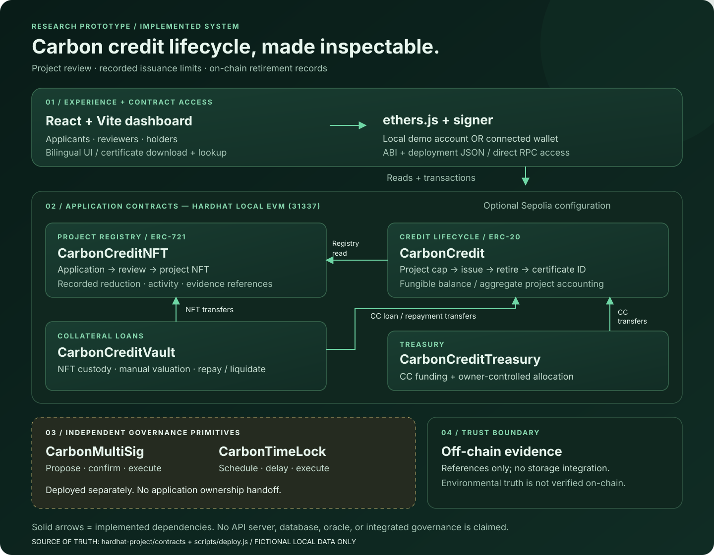
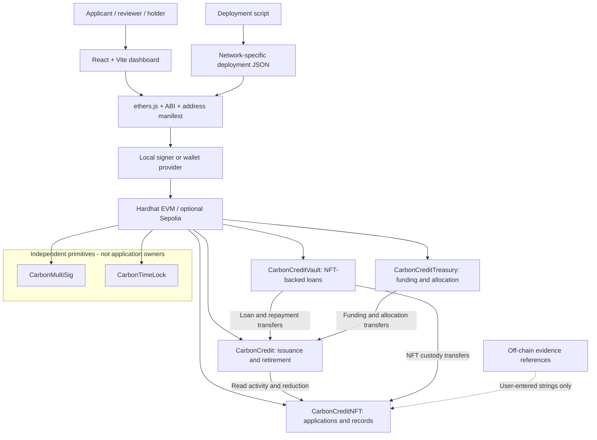

# Architecture and trust boundaries

[Overview](../README.md) · [Demo walkthrough](DEMO.md)

## Runtime layers

| Layer | Implementation | Responsibility |
| --- | --- | --- |
| Presentation | `fronted/src/App.jsx`, React/Vite | Bilingual forms, state/event reads, certificate download/query |
| Contract access | `fronted/src/contracts/contracts.js`, ethers.js 5 | ABI definitions and local/Sepolia address selection |
| Transport/signing | Local JSON-RPC signer or wallet provider | Read chain state and submit transactions; no application API server |
| Application contracts | `hardhat-project/contracts/` | Registry, accounting, collateral custody, treasury |
| Tooling | `scripts/demo.mjs`, Hardhat, deploy script | Start services, deploy six contracts, seed fixtures, write manifest |
| Verification | `hardhat-project/test/`, GitHub Actions | Behavior checks and builds; not independent audit |

## Editable relationship diagram

The SVG provides the designed overview; Mermaid provides an editable dependency map. Arrows indicate calls/dependencies, not ownership transfers.

## Lifecycle and accounting

1. `submitProject` stores an application. An owner or authorized reviewer calls `reviewApplication`; approval creates a project NFT.
2. Deployment links `CarbonCredit.projectRegistry` to the NFT registry.
3. `mintFromProject` checks issuer permission, project activity, project cap, and global cumulative issuance. It updates `projectIssued` and emits events.
4. `retireFromProject` checks the caller's balance and aggregate project issuance, burns CC, updates `projectRetired`, and stores a certificate-ID-keyed record.
5. The frontend queries `getRetirement` for verification. Downloaded HTML is a presentation, not the authoritative record.

### Units and attribution

The NFT stores tonnes multiplied by 100; CC has 18 decimals. Project capacity is `recordedReduction × 10^16` token base units. A stored reduction of 10,000 corresponds to 100 tCO₂e and a 100 CC cap. This is a prototype convention, not certification.

Retirement does not replenish cumulative issuance capacity. Owner-only `mint` is outside project accounting. Ordinary holders can also use generic `burnCarbonCredits`, which creates no project retirement certificate.

CC is fungible: project-specific balances/lots are not tracked. Naming a project during retirement is aggregate attribution, not proof that every burned unit originated there.

## Ownership and trust

The deployer initially owns all six contracts. Deployment does not transfer application ownership to multisig/timelock, establish a governance execution chain, or install an external verifier.

| Actor | Capability | Trust boundary |
| --- | --- | --- |
| Registry owner | Manage reviewers; directly mint/update/deactivate projects | Centrally administered metadata |
| Reviewer | Approve/reject applications | Role membership is not independent certification |
| Token owner | Manage issuers/registry; generic mint; pause; change cap | Privileged paths remain |
| Issuer | Issue against an active recorded project | Reduction data must be trusted off-chain |
| Vault owner | Set valuation; pause new borrowing; liquidate overdue loans | Manual appraisal |
| Treasury owner | Allocate deposited CC | Central allocation control |
| Holder | Transfer, generic burn, project-associated retirement | Transfers lose project-specific provenance |

Governance primitives can execute target calls in isolation, but privileged application calls would require explicitly granting authority. The current deployment does not do so.

## Storage and external boundaries

- Applications, metadata, issuance totals, and retirement records live in contract state. Events support dashboard history reads.
- Evidence hashes/URIs are references; no implemented IPFS upload, document validation, carbon-standard API, or price oracle exists.
- There is no persistent application database or dedicated indexer.
- Manifests contain public addresses, not private keys. Local and Sepolia manifests are separate.
- Restarting a local node loses state. A checked-in manifest is not evidence of an active deployment.

## Development boundaries

`npm run demo` starts Hardhat/Vite, seeds fictional fixtures when deployment is needed, and reuses compatible services. It does not intentionally reset an existing node and stops only its own children.

Sepolia deployment is an optional public-testnet operation. Hosting static files cannot expose localhost to remote visitors. No production deployment, audit, or real-world registry integration is asserted.

The active Solidity source path is `hardhat-project/contracts/`; root-level `contracts/` contains additional copies, not this setup's compilation sources.
